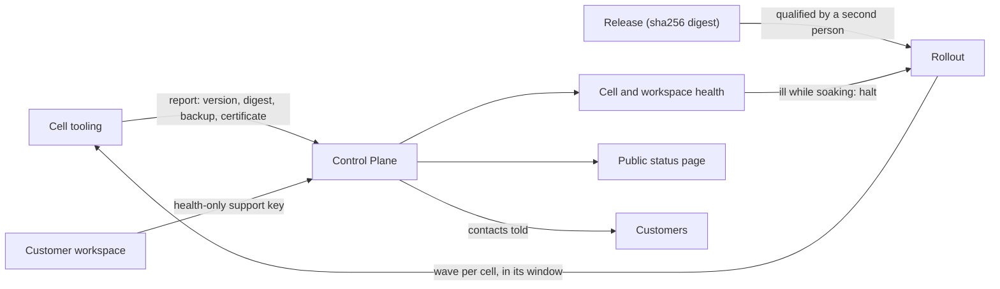
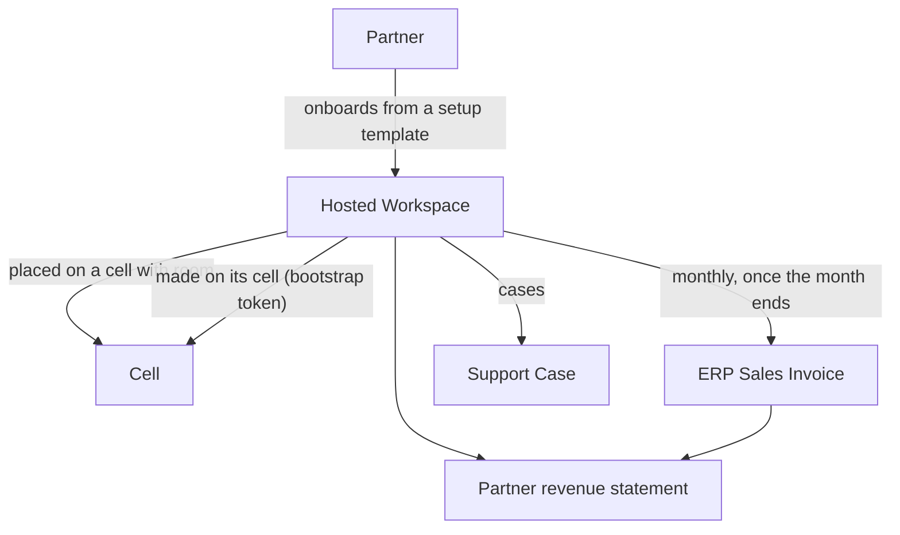

<div align="center">

<picture>
  <source media="(prefers-color-scheme: dark)" srcset="docs/assets/banner-dark.svg">
  
</picture>

<br>

[](CHANGELOG.md)
[](LICENSE)
[](https://github.com/CBFerrum/Ferrum)


### Run a fleet of Ferrum cells, roll releases out in stages, and tell customers how it is going.

Control Plane is the operations room for a hosted Ferrum service. It tracks the cells that run customers' workspaces, the releases they should run, the incidents that touch them, and the partners who bring customers. It replaces a spreadsheet of deployments, a hand-run upgrade checklist, a separate status page and a hosting-billing script.

[💡 Why](#-why-control-plane) · [📸 Screenshots](#-screenshots) · [✨ Features](#-features) · [📊 Compare](#-how-it-compares) · [📍 Roadmap](#-roadmap) · [🚀 Install](#-install) · [🔧 Develop](#-develop)

</div>

## 💡 Why Control Plane

- 🛰️ **Apart from what it runs.** It runs in a workspace of its own, away from the cells that hold customers' workspaces. It keeps where each workspace runs and on what terms, and never a workspace's records. If it is down, the cells and their workspaces carry on.
- 🔒 **Customers stay in control of access.** A workspace's health is read with a health-only support key that the customer's administrator gave. The customer sees each of those requests and can end the access whenever they choose.
- 🧾 **One digest, one release.** A release is known by its `sha256:` digest, which never changes. A second Release Manager qualifies it before it can be rolled out.
- 🪜 **Rollouts that stop themselves.** Waves wait for each cell's weekly maintenance window, soak while the cell stays healthy, and halt when a cell falls ill, misses its window or loses its release.
- 📣 **Status customers can read.** A public status page shows each cell by region, open incidents and coming maintenance, and names no customer.
- 🤝 **Partners are first-class.** Partners onboard customers from versioned setup templates, raise cases, and read monthly statements, with tiers that lapse when certification does.
- 💸 **Hosting billed through ERP.** With ERP installed, each hosted workspace is invoiced once a month for its days, plus usage beyond its terms.
- 🧩 **Open source, AGPL, on the same platform.** It is an ordinary Ferrum app, so its records have permissions, audit, search, exports, REST and MCP like everything else.

## 🎯 At a glance

| | |
|---|---|
| 📦 Version | `0.5.11` |
| 🧱 Kind | Own interface at `/control/`, plus two portal pages and a public status page |
| 🗃️ What it adds | 16 entities in the `control` package; 2 more (Hosting Billing, Hosting Invoice) in the ERP connector `control_erp` |
| 👥 Roles | 2: Fleet Operator, Release Manager (the connector extends Fleet Operator) |
| 📊 Reports | none of its own yet; the home page and status page carry the figures |
| 🖨️ Print formats | none of its own |
| ⏱️ Upkeep | one job: lapsed certifications, cell health, rollouts, workspace health, and monthly invoicing |
| 🔗 Depends on | Ferrum `>=0.3.2, <0.4`; the connector needs the `control` app `>=0.4` and ERP `>=0.1` |
| 🤝 Works with | ERP (hosting invoices), IoT Edge (gateway health in a workspace's health) |
| 🌍 Languages | English, Arabic and Hindi (translated by a model, to be reviewed by native speakers) |
| 🧪 Tests | 10 Rust tests (two are long end-to-end walks), 2 UI test files |
| 📄 Licence | AGPL-3.0-only |

## 📸 Screenshots

<!-- CONTROL-SCREENSHOTS -->

The fleet home, rollout waves, incident updates and the public status page are not pictured yet: the console shows cells and workspaces that are reporting, and a fresh clone has none. The diagrams in [How it works](#-how-it-works) show the same flows.

## ✨ Features

### 🛰️ Cells and their health

- **Cell.** A deployment of Ferrum in one region. It holds its name, region, kind (Shared or Dedicated), capacity, how many workspaces are placed, its API address, the release and configuration fingerprint it should run, and a weekly maintenance window (day, start hour, length in hours).
- **Readings from its own tooling.** A cell's tooling posts version, digest, configuration fingerprint, last backup, certificate expiry, and processor, memory and disk use. The cell's token is set on its record and kept sealed. A cell reports at most twice a minute.
- **Down.** A cell is down when it has not reported for 15 minutes or its certificate has expired.
- **Degraded.** A cell is degraded when it runs another release than it should, its configuration has drifted, its last backup is more than 26 hours old, its certificate ends within 14 days, or a resource is at 90%.
- **Fleet home.** Cells grouped by region with a placed-of-capacity bar, plus queues for open incidents, workspaces that are not healthy, and rollouts that are running or halted. The page refreshes the cell list every minute.
- **Quick create.** New cell, new rollout and new incident are one click from the home page and the Ferrum create menu.

### 📍 Hosted workspaces and placement

- **Hosted Workspace.** A customer's workspace: slug, customer, address, region, cell, status (Onboarding, Active, Closed), plan, monthly amount, term end, support plan (Standard or Premium), partner, contact and administrator emails, the setup template and revision it came from, and when it was made on its cell.
- **Placement by room.** A workspace left without a cell goes to its region's shared cell with the most room. A full cell, a down one and a dedicated one take none. A closed workspace leaves its room.
- **Made on its cell.** A fleet operator uses **Make It on Its Cell**, or a partner onboarding a customer with a first administrator gets it made at once, or is told why the cell could not. It calls the cell's `POST /api/tenants` with the cell's bootstrap token, the setup's packages and settings, and the first administrator, who chooses their own password (the one it is made with is random and kept nowhere). It is made once.
- **Health read from the workspace.** Upkeep reads each open workspace's `/api/support/report` with the health-only key its administrator gave: undelivered events, failed jobs, long queues, and what each installed app says of its own part. IoT Edge's quiet or troubled gateways are counted this way. Health is Unknown, Healthy, Degraded or Unreachable, with the problems in words.
- **Support access the customer controls.** The customer sees each request and ends the access when they choose. When the key is not given or has ended, the page says so plainly.
- **Workspace Usage.** Each health reading keeps the day's active people and the storage its files take (the day's last reading is kept). A server that does not report usage yet says nothing of it.

### 🚢 Releases and staged rollouts

- **Release.** Recorded by its `sha256:` digest, with version, provenance and notes. It starts as Candidate. A Release Manager other than who recorded it qualifies it, or it is Withdrawn. Only a qualified release is rolled out.
- **Rollout.** A qualified release taken to a list of cells, one wave at a time, with a soak time in hours. Status is Draft, Running, Halted or Done; actions are Start, Halt and Resume.
- **Waves.** Each wave is Pending, Upgrading, Soaking, Done or Failed. A wave starts when its cell's maintenance window opens and soaks once the cell runs the release and is healthy. It is done when the soak has passed.
- **One at a time.** A cell is in one running rollout at a time.
- **Halts by itself.** The rollout halts when a cell falls ill while soaking, when one is not upgraded within its window, or when its release is withdrawn, and says why.
- **Customers are told.** When a rollout starts, the contacts of the workspaces on its cells are told when to expect it.

### 📣 Incidents and public status

- **Service Incident.** A title, severity (Minor, Major, Critical), status (Investigating, Identified, Monitoring, Resolved), the cells it touches, and a Public box that ticks by default.
- **Updates stay as posted.** Each change of status is said in an update; updates are not rewritten.
- **Public status page.** Anyone reads it without signing in at `/control/status/{workspace}`, or as JSON at `/api/site/{workspace}/control/status`. It shows each cell's state by region, open incidents and those resolved in the last three days, and coming maintenance. It is read again every minute and names no customer.
- **A customer's own page.** A workspace's contact sees their service in the portal at `/portal/service/`: how the workspace is doing, coming maintenance and incidents.

### 🛟 Recovery requests

- **Recovery Request.** A restore, export or move of a workspace, with reason and (for a restore) a target. Status is Requested, then Approved or Refused, then Done.
- **A second person decides.** An operator other than who asked decides it, and a refusal carries a note.
- **The customer sees where it stands.** The restore itself is run by the cells' own tooling; the request records the decision.

### 🤝 Partners, setups and cases

- **Partner.** A firm with tier (Registered, Certified, Premier), a certified-until date, a revenue share and members. A certified or premier tier needs a certification that has not lapsed, and upkeep drops it to Registered when it does. A member may appear only once.
- **Setup Template.** A repeatable setup: the packages and apps it installs and the settings it starts with. It is versioned, so a change is a new revision and a workspace keeps the revision it was set up from.
- **Partner portfolio.** In the portal at `/portal/partner/` a partner's members see their customers' health, renewals, support access ending, open cases and setup templates, and onboard customers from a template.
- **Support Case.** Raised by a customer's contact, or by a partner's member for a workspace of theirs. It is due by the workspace's support plan and severity, counted from when it was raised, and resolving it says how.

| Support plan | Critical | High | Low |
|---|:-:|:-:|:-:|
| Premium | 1 hour | 4 hours | 24 hours |
| Standard | 4 hours | 8 hours | 72 hours |

- **Revenue Statement.** A partner's share of what its customers paid in a month, issued once the month has ended and only once for that month. It counts what each customer's workspace was invoiced for through ERP, or else what an active one pays a month.

### 💸 Hosting billing through ERP

Installed with the connector `control-erp` (package `control_erp`) when ERP is present.

- **Hosting Billing.** A settings record naming the company invoicing and the item hosting is invoiced as.
- **Per workspace.** A workspace names whom to bill (Billed To, an ERP customer) and optionally the first and last days billed. Otherwise billing runs from the day it was made on its cell to the day it was closed, by the control plane's own day.
- **Monthly, once.** After a month has ended, upkeep invoices it for each billed workspace as an ERP Sales Invoice left for accounts to issue. A month cut short pays its days' share, written "(17 of 31 days)" on the line.
- **Usage beyond terms.** A workspace's terms may name the people and GB its monthly price covers, with a price per extra person and per extra whole GB. The month is invoiced for its peak beyond them, a line each.
- **Hosting Invoice.** Keeps each month, one per workspace and month, so no month is invoiced twice.

### 🔐 Permissions and privacy

| Role | Can do |
|---|---|
| **Fleet Operator** | Runs cells and workspaces, rolls releases out, tells customers of incidents, decides recovery requests, and (with the connector) reads hosting invoices and usage. Ferrum administrators have the same rights. |
| **Release Manager** | Records releases by digest and qualifies those someone else recorded. |

- **Personal-data requests.** Contact and administrator emails on workspaces, and who raised a support case, are found and erased on request. Who asked for a restore is kept as evidence of the request.
- **Assistant.** Ferrum's assistant knows what each state means on these pages and suggests questions such as which rollouts are running or halted, and which workspaces are still onboarding.
- **Languages and mirroring.** Pages mirror right to left, with Arabic and Hindi words built in.

## 🧭 How it works

### From a cell's report to a staged rollout



A cell's own tooling does the upgrade. The control plane decides which cell goes next, when, and whether to stop, from what the cells report.

### Partners, workspaces and invoices



The workspace record holds where it runs and on what terms. The workspace's own records stay on its cell.

## 🧱 Data model

### Entities

| Entity | What it is | Key fields or states |
|---|---|---|
| Cell | A regional deployment that runs workspaces | region, kind, capacity, placed, maintenance window, reported version, digest, backup, certificate expiry |
| Hosted Workspace | A customer's workspace on a cell | slug, address, cell, Onboarding / Active / Closed, support plan, health |
| Workspace Usage | One day's people and storage | workspace, day, people, storage GB |
| Release | A build known by digest | Candidate / Qualified / Withdrawn |
| Rollout | A release taken to cells in waves | Draft / Running / Halted / Done, soak hours |
| Rollout Wave (child) | One cell's step | Pending / Upgrading / Soaking / Done / Failed |
| Service Incident | Something wrong with cells, told publicly or not | Minor / Major / Critical, four statuses, public |
| Incident Update (child) | One posted change of status | posted at, status, message |
| Recovery Request | A restore, export or move | Requested / Approved / Refused / Done |
| Partner | A firm that brings customers | Registered / Certified / Premier, certified until, members |
| Setup Template | A versioned setup | packages, apps, settings, revision |
| Support Case | A request for help | Low / High / Critical, Open / Waiting / Resolved, due at |
| Revenue Statement | A partner's month | lines, total, partner share |
| Hosting Billing (connector) | Which company and item invoice hosting | company, item |
| Hosting Invoice (connector) | One workspace-month invoiced | days, amount, peak people, peak storage, sales invoice |

### Scheduled upkeep

One job runs for the workspace holding the control plane: it lapses certifications, refreshes cells' health, moves rollouts on, reads each workspace's health, and, with the connector, invoices months that have ended.

## 🔌 Integrations

| With | How | Needs |
|---|---|---|
| ERP | The connector `control-erp` creates Sales Invoices for hosted workspaces | ERP `>=0.1` installed, a company and an item in Hosting Billing |
| IoT Edge | Its gateways count in a workspace's health through the support report | The workspace's server reporting `apps` in its support report |
| Cells' tooling | Posts readings to `POST /api/site/{workspace}/control/report` | A cell name and its token |
| Workspaces | Health from `/api/support/report` | A health-only support key from the customer |
| Cells' provisioning | `POST /api/tenants` on a cell | The cell's bootstrap token |
| Email | Workspaces' contacts get a planned-maintenance mail when a rollout starts | The platform's mailer |
| Private networks | Polling workspaces on private addresses | `FERRUM_WEBHOOKS_ALLOW_PRIVATE` |

A cell's report looks like this:

```bash
curl -X POST "https://control.example/api/site/<workspace>/control/report" \
  -H "x-control-cell: eu-1" -H "x-control-token: $CELL_TOKEN" -H "content-type: application/json" \
  -d '{"version": "0.4.1", "digest": "sha256:…", "config": "…", "backup_at": "2026-11-04T01:00:00Z",
       "certificate_expires_at": "2027-01-10T00:00:00Z", "cpu": 20, "memory": 35, "disk": 41}'
```

## 📊 How it compares

The closest products are fleet and hosting managers: Rancher and Portainer manage clusters and containers, Plesk manages servers and sites, and WHMCS bills and supports hosted accounts. None is the same thing: Control Plane runs a fleet of one product's cells, with its releases, status and partners.

| Capability | Ferrum Control Plane | Rancher | Portainer | Plesk | WHMCS |
|---|:-:|:-:|:-:|:-:|:-:|
| Inventory of deployments with health | ✅ | ✅ | ✅ | 🟡 | ❌ |
| Down and drift detection from reports | ✅ | 🟡 | 🟡 | ❌ | ❌ |
| Placement by capacity and region | ✅ | ➖ | ➖ | ❌ | ❌ |
| Provisioning new infrastructure | ❌ | ✅ | 🟡 | ❌ | 🟡 |
| Releases known by immutable digest | ✅ | ❌ | ❌ | ❌ | ❌ |
| Qualification by a second person | ✅ | ❌ | ❌ | ❌ | ❌ |
| Staged rollouts in waves | ✅ | 🟡 | ❌ | ❌ | ❌ |
| Maintenance windows per deployment | ✅ | ❌ | ❌ | ❌ | ❌ |
| Soak and automatic halt | ✅ | ❌ | ❌ | ❌ | ❌ |
| Role-based access | ✅ | ✅ | ✅ | ✅ | ✅ |
| Incidents with updates | ✅ | ❌ | ❌ | ❌ | 🟡 |
| Public status page | ✅ | ❌ | ❌ | ❌ | 🟡 |
| Customers told before maintenance | ✅ | ❌ | ❌ | ❌ | 🟡 |
| Customer-controlled health access | ✅ | ➖ | ➖ | ➖ | ➖ |
| Recovery requests with second approval | ✅ | ❌ | ❌ | ❌ | ❌ |
| Executing restores and backups | ❌ | 🟡 | 🟡 | ✅ | ❌ |
| Partner / reseller portfolio | ✅ | ❌ | ❌ | 🟡 | 🟡 |
| Versioned setup templates | ✅ | 🟡 | 🟡 | 🟡 | 🟡 |
| Support cases with due times | ✅ | ❌ | ❌ | ❌ | ✅ |
| Monthly invoicing of hosted accounts | ✅ | ❌ | ❌ | ❌ | ✅ |
| Usage-based invoice lines | ✅ | ❌ | ❌ | ❌ | ✅ |
| Payment gateways | ❌ | ➖ | ➖ | ➖ | ✅ |
| Partner revenue statements | ✅ | ❌ | ❌ | ❌ | 🟡 |
| Never holds the customers' own records | ✅ | ➖ | ➖ | ➖ | ➖ |
| Open source and self-hosted | ✅ | ✅ | ✅ | ❌ | ❌ |
| Same data as accounting and the rest of the business | ✅ | ❌ | ❌ | ❌ | ❌ |

Notes: Rancher's rollouts are GitOps targeting through Fleet, not release waves with windows. Plesk and WHMCS rows marked 🟡 for incidents, status and partners reflect network-issue notices, reseller features and affiliate tools that are narrower than a cell-level status and partner portfolio. Setup templates in the leaders are provisioning blueprints or cluster templates, and are not versioned per workspace.

### 🏆 Where Control Plane stands out

- 🧾 **Release discipline.** Immutable digests, a second person to qualify, waves in each cell's window, and automatic halt.
- 🛰️ **It is not in the blast radius.** It runs apart from the cells and keeps no customer records.
- 🤝 **Operators, partners and customers in one place.** Fleet, status, cases, statements and invoices share one data set.
- 🔐 **Customer-controlled access.** Health is read with a key the customer gives and can end.

### 🚧 Where the leaders are still ahead

- 🏗️ **Provisioning.** Rancher creates clusters. Cells here are made by their operators' tooling and report in.
- 💾 **Backups and restores.** Plesk runs them. A recovery request here records the decision, not the restore.
- 💳 **Payment.** WHMCS has payment gateways. Here, invoices are paid as ERP takes payments.
- 🧰 **Breadth.** The leaders manage workloads, sites, domains and mail; this manages one product's fleet.

> [!NOTE]
> Leader columns are from public product information as of November 2026 and may change.

## 📍 Roadmap

### ✅ Recently shipped

- [x] **0.5.11** The interface rebuilt on the tuned design system: better menu icons, a lighter first page, a visible scroll cue, cleaner print.
- [x] **0.5.10** The redesigned interface: upgraded design system, shaped loading, told-apart states, a work home with queues.
- [x] **0.5.9** Names in Arabic and Hindi; the last English sentences translated.
- [x] **0.5.7** The assistant knows its records.
- [x] **0.5.1** A new incident's Public box shows ticked, as it is saved.
- [x] **0.5.0** A workspace's health counts what its installed apps say of their own parts, IoT Edge's gateways among them.
- [x] **0.4.0** Daily usage from each health report; with ERP, people and storage beyond terms charged at the month's peak.
- [x] **0.3.0** With ERP, hosted workspaces invoiced monthly for their days; partner statements count what was invoiced.

### 🔜 Next up

- [ ] **Provision a cell from here.** Cells are made by their operators' tooling today and report in.
- [ ] **Install a setup's store apps when the workspace is made.** Today its administrator installs them from the App Manager.
- [ ] **Run backups and restores.** Today they belong to the cells' tooling, and a recovery request records the decision.
- [ ] **Price lists and payment gateways.** Invoices go out in the invoicing company's currency; payment gateways wait for their keys.

### 🔭 Later

- [ ] Partner certification by exams or trained staff.
- [ ] Apps' own health on older servers: it shows only once a workspace's server reports `apps`.
- [ ] Reports and print formats of its own.
- [ ] Charge usage prorated within a month (today it is the month's peak).

## 🚀 Install

Control Plane is built into the Ferrum server and installed from **Apps** (`/store/`) in a workspace of its own, kept apart from the cells that run customers. The ERP connector (`control-erp`) ships with it and is offered where ERP is also installed.

First steps:

1. Give people the **Fleet Operator** and **Release Manager** roles.
2. Add a **Cell** with its region, capacity and maintenance window, and set its token so its tooling can report.
3. Record a **Release** by digest and have a second Release Manager qualify it.
4. Add **Hosted Workspaces** and ask each customer's administrator for a health-only support key.
5. With ERP, fill **Hosting Billing** with the company and item, then name whom each workspace is billed to.

## 🔧 Develop

```bash
cargo test                       # needs FERRUM_CONTROL_TEST_DATABASE_URL's database
cd ui && npm run build && npm run check
```

CI creates a non-superuser role (so row-level security applies) and two databases, `ferrum_control_test` and `ferrum_control_erp_test`, and sets `FERRUM_CONTROL_TEST_DATABASE_URL` and `FERRUM_CONTROL_ERP_TEST_DATABASE_URL` for them. It also runs `cargo fmt -- --check` and `cargo clippy --all-targets -- -D warnings`, and for the interface `npm run check`, `npm run typecheck` and `npm test` against a Ferrum-Frontend checkout at `../ferrum/web`.

`tests/control_it.rs` runs the control plane in one workspace and a customer's in another. It walks releases recorded and qualified, cells reporting (healthy, degraded, down, quiet), workspaces placed by room, health read and refused once the key is revoked, a rollout through two windows that halts twice and one that finishes, incidents and the public status, recovery requests, a partner's page, onboarding, cases and statement, workspaces made on their cell through a stand-in, a customer's own page, and who may do what.

`tests/billing_it.rs` runs the connector with ERP's records in a workspace whose day is never UTC's: months invoiced once after they end, the first and last month, none for a workspace with nobody to bill, a partner's statement counting what was invoiced, and who may do what.

## 📂 Project layout

```text
app.yaml          the manifest: id, version, what it adds to Ferrum
packages/control/       entities, roles, personal-data rules
packages/control_erp/   the ERP connector's entities, roles and overlays
connectors/erp/   the connector's manifest (control-erp)
src/              fleet, hosting, partners, billing and the public and signed-in endpoints
ui/               its own interface (React + Vite), locales for Arabic and Hindi
tests/            integration tests against a real PostgreSQL
docs/             PROVENANCE.md
```

## 📜 Changelog

Every version is in [CHANGELOG.md](CHANGELOG.md).

## 🤝 Contributing

Issues and pull requests are welcome at [github.com/CBFerrum/ferrum-app-control/issues](https://github.com/CBFerrum/ferrum-app-control/issues). Run `cargo fmt`, `cargo clippy --all-targets -- -D warnings` and `cargo test` before sending a change.

## 📄 License

[AGPL-3.0-only](LICENSE), like the platform.

<div align="center">

<sub>Part of <a href="https://github.com/CBFerrum/Ferrum">Ferrum</a>, the open business platform · Made with 🦀 Rust and 🐘 PostgreSQL</sub>

</div>
